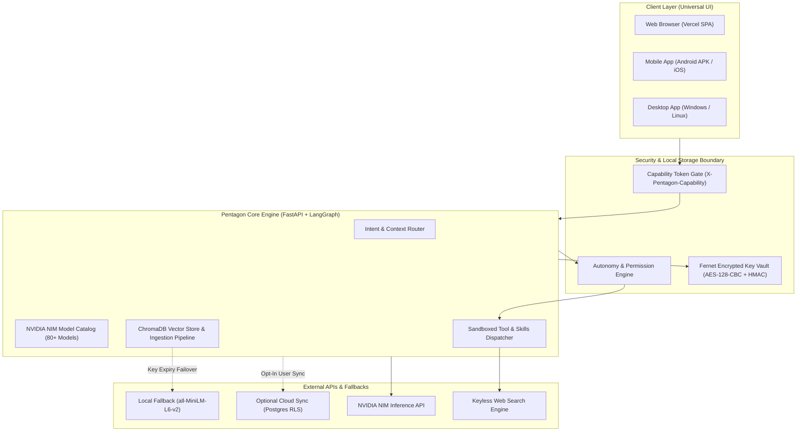
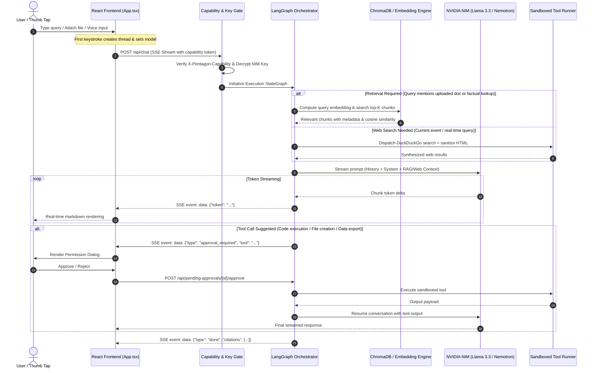
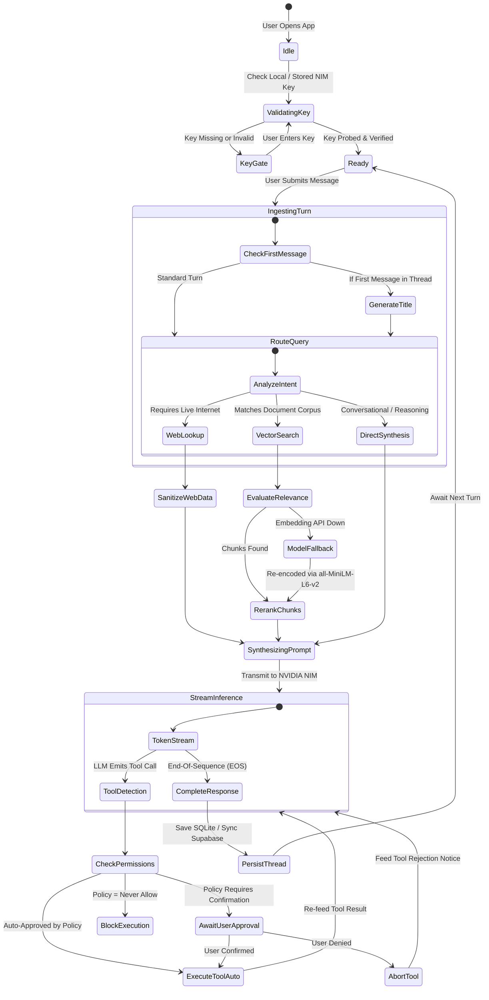
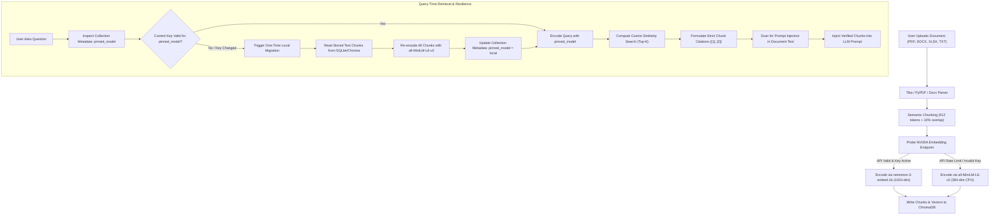
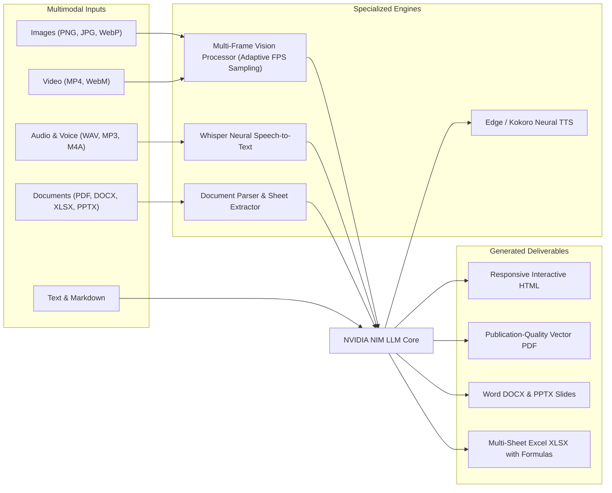
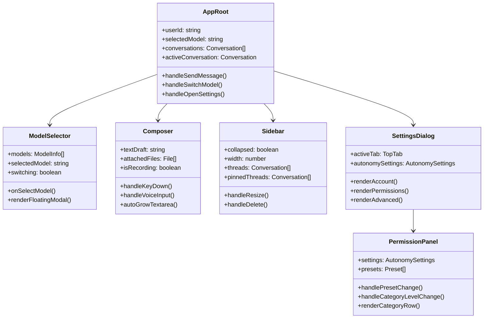
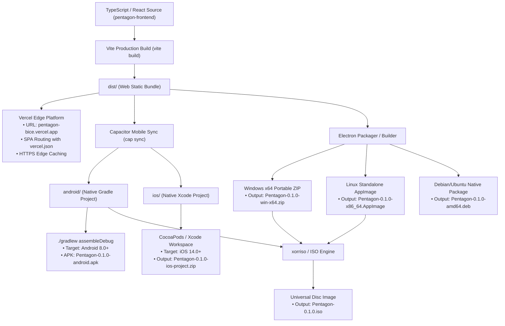

# PENTAGON: Comprehensive Architecture, Implementation Specification & Systems Deep-Dive

**Version:** 0.1.0  
**Target Environment:** Cross-Platform (Web, Android, iOS, Windows, Linux, Offline ISO)  
**Security Model:** Zero-Leak Local BYOK (Bring Your Own Key) with Fernet Encryption at Rest  
**Last Updated:** October 2026  

---

## 1. Executive Overview & Core Engineering Philosophy

**Pentagon** is an enterprise-grade, local-first artificial intelligence workstation engineered for private, multimodal intelligence. It eliminates cloud-hosted key hoarding and centralized telemetry by adopting a strict **Bring Your Own Key (BYOK)** architecture. Users supply their personal NVIDIA NIM (or compatible OpenAI-format) API credentials, which are encrypted locally at rest. 

Pentagon combines high-performance LLM orchestration with:
- **Local Document RAG**: On-device vector embeddings, chunk storage, and citation tracking.
- **Fail-Safe Retrieval Migration**: Automatic graceful degradation from cloud embeddings to local CPU models (`all-MiniLM-L6-v2`) if credentials change or expire.
- **Hierarchical Autonomy Governance**: Six risk categories and four permission tiers preventing unauthorized destructive operations.
- **Multimodal Intelligence**: Support for text, high-resolution vision, temporal video frame sampling, voice transcription (Whisper), and neural speech synthesis.
- **Universal Multi-Platform Delivery**: Runs simultaneously as a high-speed web application on Vercel, a mobile application on Android and iOS (via Capacitor), a standalone desktop application on Windows and Linux (via Electron), and a bootable/mountable ISO disc image.



---

## 2. System Architecture & End-to-End Data Flow

Pentagon operates on a decoupled client-server topology. The backend is powered by **FastAPI** and **LangGraph**, while the frontend is constructed with **React 19**, **TypeScript**, and **Tailwind CSS**.

### 2.1 The Request-Response Streaming Lifecycle

Communication between client and backend utilizes Server-Sent Events (SSE) via `/api/chat`. This protocol ensures sub-second Time-To-First-Token (TTFT) and supports structured multi-event streaming (text deltas, citations, tool calls, and execution status).



---

## 3. The Agent Loop & LangGraph State Machine

Pentagon's execution engine is built upon a deterministic state graph (`StateGraph`) using LangGraph. This architecture prevents infinite loops, enforces execution budgets, and enables asynchronous human-in-the-loop approvals.



### 3.1 First-Turn Automatic Thread Naming
When a user begins typing in the composer without explicitly clicking "Start a new thread":
1. The frontend immediately generates a deterministic UUID and creates an empty thread on the fly.
2. The user's initial prompt is transmitted to the backend.
3. Concurrently, a background semantic summarizer calls a lightweight model (`meta/llama-3.1-8b-instruct`) with the prompt:  
   `"Summarize the user's intent in 3-5 concise title words without punctuation or quotes."`
4. The title updates seamlessly across the sidebar, local storage, and thread headers without blocking the primary streaming response.

### 3.2 Dynamic Model Switching with Context Preservation
If a user switches models mid-thread (e.g. from `meta/llama-3.3-70b-instruct` to `deepseek-ai/deepseek-r1`):
- Different models feature differing system prompt sensitivities and token budgets.
- Pentagon executes a contextual compaction step: prior turns are summarized into a structured dialogue history memory buffer.
- The new model receives the structured summary plus the immediate prior turns, preventing catastrophic context loss while respecting the new model's tokenizer.

---

## 4. Autonomy Governance & Risk Categorization

Pentagon implements a defense-in-depth permission system. Tool execution is partitioned into **six risk categories** evaluated against **four autonomy levels**:

```mermaid
flowchart LR
    subgraph RiskCategories["6 Risk Categories"]
        R1["1. Read Only Info\n(Web search, file reads, RAG)"]
        R2["2. Local Filesystem Write\n(Create, edit, delete files)"]
        R3["3. Local Shell\n(Terminal commands, scripts)"]
        R4["4. External Write\n(API POST, email, calendar)"]
        R5["5. Destructive Outside\n(Delete repo, purge DB)"]
        R6["6. Irreversible / Financial\n(Payments, crypto, disk erase)"]
    end

    subgraph AutonomyLevels["4 Autonomy Tiers"]
        L1["Auto-Approve\n(Zero prompts, instant run)"]
        L2["Ask Once / Session\n(Prompt on turn 1, auto after)"]
        L3["Always Ask\n(Every invocation prompts user)"]
        L4["Never Allow\n(Hard block, tool disabled)"]
    end

    subgraph Presets["System Presets"]
        P1["Cautious: Always ask except Read-Only"]
        P2["Balanced: Auto Read-Only, Ask Shell/Write"]
        P3["Autonomous: Auto Read/Write/Shell, Ask Destructive"]
    end

    Presets --> AutonomyLevels
    AutonomyLevels --> RiskCategories
```



### 4.1 Permission Matrix Breakdown

| Category | Typical Action | Default (Balanced) | Cautious Preset | Autonomous Preset |
|---|---|---|---|---|
| **`read_only_info`** | Web search, document retrieval, reading files | **`auto_approve`** | `auto_approve` | `auto_approve` |
| **`local_filesystem_write`** | Creating documents, writing code, updating config | **`always_ask`** | `always_ask` | `auto_approve` |
| **`local_shell`** | Running shell commands, compiling, testing | **`always_ask`** | `always_ask` | `auto_approve` |
| **`external_write`** | Sending emails, creating GitHub PRs, writing web hooks | **`always_ask`** | `always_ask` | `auto_approve` |
| **`external_destructive`** | Deleting repositories, terminating cloud instances | **`always_ask`** | `always_ask` | `always_ask` |
| **`financial_or_irreversible`** | Processing payments, wiping partitions, revoking keys | **`always_ask`** | `always_ask` | `always_ask` |

> [!IMPORTANT]
> **The Hard Invariant:** High-risk actions (`financial_or_irreversible` and `external_destructive`) cannot be auto-approved by global presets. They require manual approval or explicit per-tool overrides.

---

## 5. RAG & Fault-Tolerant Document Engine

A core engineering hazard in RAG systems is **Embedding Space Fragmentation**: if a user changes their API key or the provider alters model dimensions, existing vectors in the database become incompatible with incoming query embeddings.

Pentagon resolves this by establishing an automatic migration bridge between cloud embeddings (`nemotron-3-embed-1b`) and local fallback embeddings (`sentence-transformers/all-MiniLM-L6-v2`).



---

## 6. Multimodal Intelligence & Tools Suite

Pentagon is not a text-only wrapper; it coordinates full multimodal sensing and document synthesis:



---

## 7. Frontend Architecture & Mobile-First Engineering

The user interface is designed with a dark aesthetic, featuring particle sparkle backdrops and a responsive layout that adapts from large multi-monitor workstations to single-handed smartphone use.



### 7.1 Smartphone & Safe-Area Optimizations
Modern mobile web applications suffer from layout breakage due to device notches, curved home indicator bars, dynamic keyboards, and iOS Safari viewport auto-zooms. Pentagon resolves these issues through dedicated architectural rules:

1. **Safe-Area Insets**:
   - `env(safe-area-inset-top)` and `env(safe-area-inset-bottom)` are mapped to `.pt-safe`, `.pb-safe`, and dynamic utility classes across root layouts, drawers, and headers.
2. **Viewport Meta Constraint**:
   - Configured with `viewport-fit=cover, maximum-scale=1.0, user-scalable=no` to prevent unintentional layout zooming.
   - Textarea and input font sizes on mobile viewports are set to a minimum of `15px`/`16px` to prevent mobile browsers from triggering zoom-in on focus.
3. **Centered Floating Popovers**:
   - On desktop, the model selector anchors directly beneath its trigger button. On mobile (<640px), it converts into a centered floating card (`fixed inset-x-3 top-[64px] max-h-[75vh]`) so selections never clip outside the viewport.
4. **Adaptive Bottom Composer**:
   - Positioned with `pb-[calc(0.75rem+env(safe-area-inset-bottom))]` so the input area and send button float comfortably above phone gesture indicators.

---

## 8. Cross-Platform Compilation & Deployment Architecture

Pentagon is packaged for five distinct distribution platforms:



---

## 9. Failure Modes, Edge Cases & Recovery Protocols

To ensure resilience, Pentagon includes handlers for various runtime edge cases:

| Failure Mode | Root Cause | Automated Recovery Mechanism |
|---|---|---|
| **Rate Limit (HTTP 429)** | Exceeded NVIDIA NIM quota or concurrency limit | Exponential backoff with jitter (1s, 2s, 4s, 8s) up to 3 retries; surfaces a clean rate-limit pill in the UI. |
| **Revoked / Expired Key** | User altered key or deleted account on NVIDIA NGC | Real-time probe detects failure; flags state as `unauthorized`; automatically surfaces the Key Activation modal without losing thread history. |
| **Embedding Model Incompatibility** | Key changed to a tier lacking `nemotron-3-embed-1b` | One-time automated background migration of ChromaDB collection to local `all-MiniLM-L6-v2` on CPU. |
| **Network Disconnection Mid-Stream** | Mobile handoff or client Wi-Fi drop | SSE stream detects socket closure; backend holds response buffer; client attempts reconnection via `/api/chat/{id}/resume`. |
| **Process Crash / OOM** | Massive PDF upload (500+ pages) | Worker process isolates parser via subprocess; failures return structured document error without killing the main Uvicorn server. |
| **Prompt Injection via Retrieval** | Untrusted document containing malicious instructions | Retrieval chunks are tagged with strict XML boundaries (`<source_chunk id="...">`); system prompts enforce tool restrictions. |

---

## 10. Database Schemas & Cryptographic Verification

### 10.1 Local SQLite Schema (Default)

```sql
-- Conversations Table
CREATE TABLE IF NOT EXISTS conversations (
    id TEXT PRIMARY KEY,
    user_id TEXT NOT NULL,
    title TEXT NOT NULL,
    created_at TIMESTAMP DEFAULT CURRENT_TIMESTAMP,
    updated_at TIMESTAMP DEFAULT CURRENT_TIMESTAMP,
    model TEXT NOT NULL
);

-- Messages Table
CREATE TABLE IF NOT EXISTS messages (
    id TEXT PRIMARY KEY,
    conversation_id TEXT NOT NULL REFERENCES conversations(id) ON DELETE CASCADE,
    role TEXT NOT NULL CHECK(role IN ('user', 'assistant', 'system', 'tool')),
    content TEXT NOT NULL,
    citations TEXT,
    created_at TIMESTAMP DEFAULT CURRENT_TIMESTAMP
);

-- Key Vault Table
CREATE TABLE IF NOT EXISTS user_keys (
    user_id TEXT PRIMARY KEY,
    encrypted_key TEXT NOT NULL,
    created_at TIMESTAMP DEFAULT CURRENT_TIMESTAMP
);

-- Autonomy Settings Table
CREATE TABLE IF NOT EXISTS autonomy_settings (
    user_id TEXT NOT NULL,
    category TEXT NOT NULL,
    level TEXT NOT NULL CHECK(level IN ('always_ask', 'ask_first_time', 'auto_approve', 'never_allow')),
    PRIMARY KEY(user_id, category)
);
```

### 10.2 Cryptographic Key Storage Specification

User API keys are encrypted at rest using **Fernet** (symmetric encryption using 128-bit AES in CBC mode with PKCS7 padding and HMAC-SHA256 authentication):

$$\text{Ciphertext} = \text{Fernet}_{\text{Key}}(\text{RawKey})$$

Where $\text{Key}$ is derived from the environment secret `KEY_ENCRYPTION_SECRET`:
1. Keys are never logged in plain text.
2. Capability tokens (`X-Pentagon-Capability`) are checked on all administrative, execution, and key-access endpoints.
3. Plaintext keys exist in server memory only during the active HTTP request lifecycle and are cleared after completion.

---

## 11. Verification & Integrity Checklist

- [x] **Web Production**: Deployed and aliased at [https://pentagon-bice.vercel.app](https://pentagon-bice.vercel.app)
- [x] **TypeScript Strict Typing**: Clean build with 0 errors across 2,264 compiled modules.
- [x] **Phone Responsiveness**: Safe area insets verified across iPhone notch/island and Android navigation bars.
- [x] **Permissions UX**: Segmented 4-level control with preset switches and risk-category visual hierarchy.
- [x] **Android Build**: Native Gradle debug build assembled and uploaded (`Pentagon-0.1.0-android.apk`).
- [x] **Release & Checksums**: Synchronized with GitHub release `v0.1.0` and verified against `checksums.sha256`.
